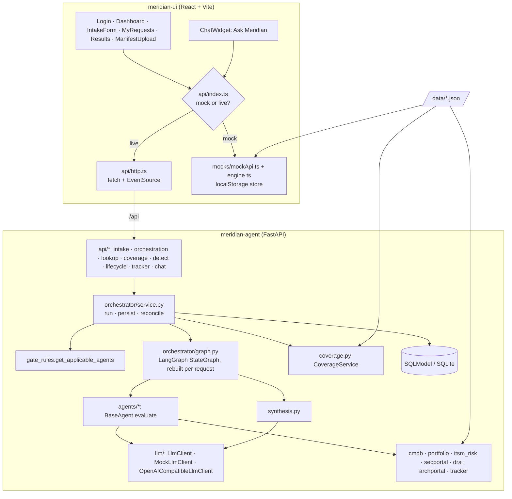
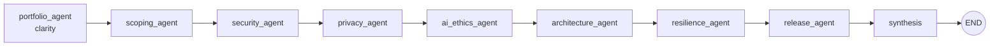
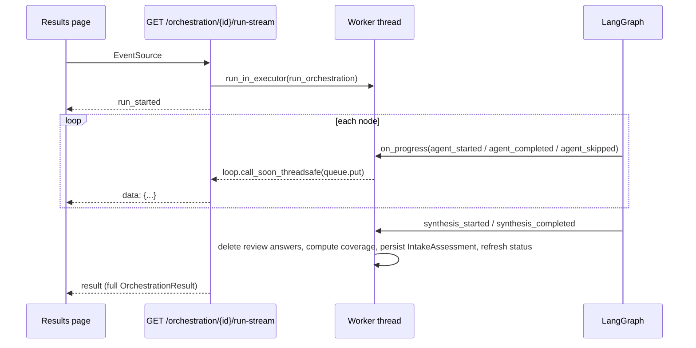
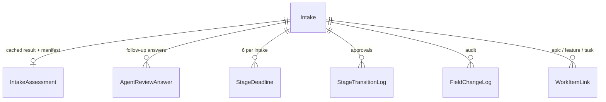

# Meridian architecture

## Components

## Orchestration graph

The graph is linear. An agent that the gate rules suppress still has a node; that node emits `agent_skipped` and returns `SKIPPED` evidence with `not_applicable=true`. Skipped agents are left out of the overall status and the STP decision.

| Agent | Runs when | Review system | Key rules |
|---|---|---|---|
| Portfolio Impact (`clarity`) | always | Portfolio | NEEDS_REVIEW on regulatory notification, material IBS impact, a new vendor or a High ITSM risk band; auto-answers 6 impact questions |
| Scoping | always | Change Mgmt | Derives control scope and governance track (FAST_TRACK / STANDARD / ENHANCED) |
| Security | TECH_CHANGE / NEW_SERVICE, internet-facing, or payment data | Security Portal | High-risk changes call `submit_assessment()` and turn the required controls into activities. A compound-risk check compares the design evidence with the intake |
| Privacy | personal, sensitive or cross-border data | DRA | Lawful basis, sensitive data, cross-border transfer; prefills DRA answers |
| AI Ethics | AI/ML component present | DRA | Autonomy, biometric data, regulatory scope, model-risk class, explainability |
| Architecture | TECH_CHANGE / NEW_SERVICE, external-facing, vendor, or new pipeline | Architecture Portal | Capability impact report; review if user growth > 25%, an SLA is specified, or new technology is introduced |
| Resilience | IBS, DR, customer-impacting, or NEW_SERVICE | Business Impact | RTO/RPO fall back to the CMDB snapshot; IBS score; FLAGGED for IBS + customer impact + outage |
| Change & Release (`release`) | always | Change Mgmt | STP iff no outage, no customer impact, and a backout plan or automated pipeline. Creates a tracker task when STP-eligible |

Each agent follows the same three steps:

1. Deterministic rules produce the status, derived fields and a fallback rationale with follow-up questions.
2. **One** LLM call rewrites the rationale and follow-ups. It is wrapped in `try/except`; on failure it logs a WARNING and keeps the deterministic text. If the rewrite returns a different number of follow-ups, it is ignored, because review answers are matched to those strings.
3. The agent returns `AgentEvidence`.

Overall status priority is FAILED > FLAGGED > NEEDS_REVIEW > REVIEWED / AUTO_APPROVED > PENDING. **STP** requires the release agent to be eligible *and* every applicable agent to be AUTO_APPROVED or REVIEWED.

## Streaming run

## Initiative status

`derive_initiative_status()` checks these in order:

| Status | Shown as | Condition |
|---|---|---|
| COMPLETED | Completed | stage is Production |
| REJECTED | Blocked | current stage overdue **and** unresolved agents (or no assessment yet) |
| ORCHESTRATING | At Risk | overdue, or due within `AT_RISK_THRESHOLD_DAYS` |
| AWAITING_HUMAN_INPUT | Awaiting Input | an agent is NEEDS_REVIEW, FLAGGED or FAILED |
| SUBMITTED | On Track | otherwise |

Statuses depend on today's date. List, summary and metrics calls refresh them in bulk with three queries and one commit before SQL filtering and sorting.

## Stage deadlines

When first read, deadlines are seeded lazily: the time between submission and `target_go_live` is split evenly across the 6 stages, with a 90-day window if go-live is missing or already past. The UI can edit each deadline, and edits are recorded in `FieldChangeLog`. `POST /lifecycle/{id}/advance-stage` returns 422 unless every non-skipped agent is AUTO_APPROVED or REVIEWED and the comment is not empty. Each successful advance writes a `StageTransitionLog` row.

## Coverage

`CoverageService` loads `question_coverage_map.json`, which maps each question to the canonical field(s) it asks for and to the agent that owns it. A question counts as answered when **any mapped intake field has a value**, or when **its owning agent ran** (skipped or failed agents don't count). Coverage % is answered ÷ 120. The service also reports per-agent and per-system breakdowns. The intake form's live "questions replaced" counter uses the same rule, assuming every applicable agent runs.

## Data model

`Intake` holds the 60 canonical fields plus `current_stage`, `status`, `cmdb_snapshot` (JSON, captured once at autofill) and `si_design_evidence` (JSON extracted from an uploaded design). Startup runs `create_all`, then an idempotent column auto-migration list and a normalization pass for legacy stage aliases.

## Security notes

- All queries go through SQLModel or SQLAlchemy with bound parameters. Raw DDL uses only identifiers from a constant list.
- API boundaries validate input: enum values, email and CI formats, length and range limits, whitelisted `sort_by`, a `Literal` sort direction, and bounded page sizes.
- Uploads must be `.txt`, `.pdf` or `.docx` with an extension/content-type check, a 2 MB size cap and a sanitised file name. `.docx` files are size-checked before their XML is read (zip-bomb guard). Files are processed in memory and never written to disk.
- Manifest HTML is built with `html.escape` on every value. UI previews also pass through a tag whitelist sanitizer that removes all attributes.
- No secrets are in the code. The LLM key comes only from `MERIDIAN_LLM_API_KEY`, and `env-config.js` values are reduced to URL-safe characters.
